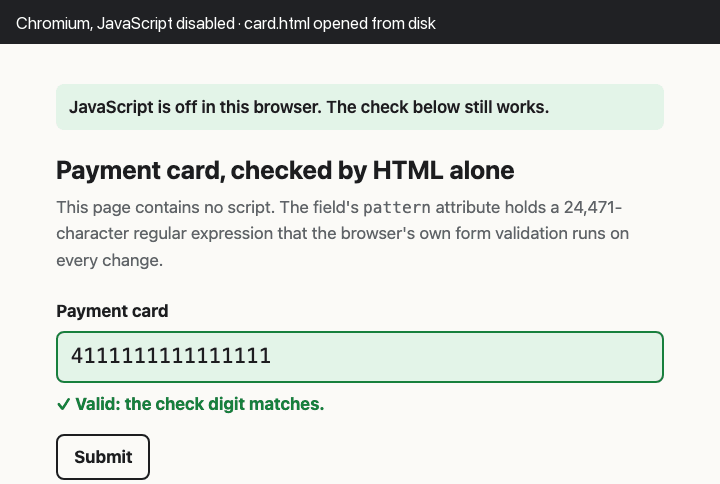

# rexsum

The last digit of a credit card number is a checksum. So is the last digit of an ISBN, a barcode,
an IMEI, a US routing number, the two digits after the country code in an IBAN, and the last two
characters of an LEI, the code that identifies a company in financial reporting. Every
validation guide says the same thing about them: a regular expression can check the format, but
the checksum needs code.

rexsum compiles the checksum itself into a regular expression, and makes it small enough to hand
to the browser in a plain HTML `pattern` attribute. No JavaScript runs. The browser's own form
validation does the arithmetic:

```html
<input inputmode="numeric" pattern="(?=\d{12,19}$)(?=(?:(?:[02468]|[13579]…">   <!-- 24,471 characters -->
```

<picture>
  <source media="(prefers-reduced-motion: reduce)" srcset="media/demo-poster.png">
  
</picture>

**[Try online](https://fmindstormer.github.io/rexsum/) ·
[Download HTML](https://fmindstormer.github.io/rexsum/examples/card.html) ·
[Read the construction](#how-the-arithmetic-gets-into-the-syntax)**

## Use it

Every shipped pattern comes as a standalone page in [`site/examples/`](site/examples/), also
[online](https://fmindstormer.github.io/rexsum/examples/card.html) and zipped with each
[release](https://github.com/fMindstormer/rexsum/releases): a field, a valid and an invalid
sample, and CSS that colours the field by `:valid` and `:invalid`. No script, no external files.
Open one from disk, turn JavaScript off, and change the last character.

To put a pattern into your own form:

```sh
python -m rexsum --list                     # the shipped schemes
python -m rexsum card                       # the pattern
python -m rexsum card --html                # as an <input> element, with the right keyboard
python -m rexsum custom --weights 1,3 --mod 10 --length 13     # your own weighted sum
python -m rexsum iban DE                    # an IBAN pattern (16 countries built in)
python -m rexsum iban LU --layout 3n13c     # any other country, layout from the IBAN registry
python -m rexsum lei                        # Legal Entity Identifiers
```

Python 3.10 or later, no dependencies. A browser never tests an empty field against the pattern,
so add `required` if the field must be filled. `patterns.json` holds every pattern with its size
and parts.

The rest of this README explains what kind of machine a `pattern` attribute is, why getting
arithmetic into it is hard, the four constructions that make it fit, how the results hold up in
real browsers, and where this sits next to earlier work.

## The machine you are programming

A `pattern` attribute is a very small computer. The browser takes the pattern P, compiles
`^(?:P)$` with JavaScript's `v` flag, and runs it against the field's whole value whenever the
value changes. Out comes one bit: valid or invalid. That bit drives the `:invalid` CSS state and
blocks the form from submitting.

That is all you get. There are no variables, no loops that carry a value forward, no arithmetic,
no way to print anything. The only instructions are those of a JavaScript regex:

- characters and character classes (`7`, `[02468]`)
- sequence, alternation and repetition (`ab`, `a|b`, `a*`, `a{3}`)
- lookaheads and lookbehinds (`(?=…)`, `(?!…)`, `(?<=…)`): tests that look at the input without
  consuming it. Two lookaheads at one position mean AND, a negative one means NOT.
- capture groups and backreferences (`(…)`, `\5`): remember a piece of the input, and later
  require the same text again.

Two details shape everything below. A pattern the browser cannot compile is silently dropped, so
the field accepts anything: the patterns must be exactly right in every engine, not roughly
right. And an empty field is never checked (add `required` for that).

### Why a checksum fits in principle

Without groups and backreferences, a regex is a finite automaton in disguise. It remembers
nothing but which state it is in. That sounds hopeless for arithmetic, but a check digit only ever
needs a running remainder: Luhn's sum modulo 10, plus whether the next digit gets doubled. That
is a finite amount of memory, 20 states for Luhn, so a finite automaton can check it. By Kleene's
theorem, every finite automaton can be written as a regular expression.

For small cases the result is even readable. Here are the numbers whose digit sum is a multiple
of 3, which are exactly the multiples of 3, in 125 characters:

```
(?=\d+$)(?:(?:(?:[147]|[258][0369]*[258])(?:[0369]|[147][0369]*[258])*(?:[147][0369]*[147]|[258])|[0369]|[258][0369]*[147])*)
```

`[0369]` leaves the remainder alone, `[147]` adds 1, `[258]` adds 2, and the nesting walks
around a cycle of three remainders until it returns to zero.

### Why it fails in practice

The conversion exists, but it explodes. The same digit-sum language takes 1,463 characters for
modulus 5 and 16,647 for modulus 7, about eleven times more for each step. Converted the
textbook way, Luhn's 20-state automaton comes out at **37,396,808 characters**. That is not an
attribute you can ship; a published Luhn regex of that size makes grep and ripgrep run out of
memory (see Where this sits).

So the real problem is compression: find a regex for the same language that is thousands of times
smaller. rexsum gets Luhn to 24,465 characters, 1,500 times smaller.

## How the arithmetic gets into the syntax

### 1. Split the modulus with lookaheads

A number is divisible by 10 exactly when it is divisible by 2 and by 5. That is the Chinese
remainder theorem, and a JavaScript regex can express the "and": `(?=A$)B` matches exactly what
both `A` and `B` match. So Luhn becomes two independent checks, a mod-2 automaton and a mod-5
automaton, each converted on its own.

This is where most of the size goes away, because conversion cost grows much faster than the
number of states. The mod-2 part takes 198 characters. All the remaining difficulty is in the
mod-5 part.

### 2. Remove states in the right order

The textbook conversion, state elimination, removes the automaton's states one at a time and
rewrites the edges around each one. The order does not change the language, but it changes the
size by orders of magnitude, and no known rule finds the best order.

Luhn's weights repeat, 1, 2, 1, 2, …, so rexsum removes the states inside one period first. What
is left reads two digits at a time and has only 5 states, few enough to try all 120 orders and
keep the best. On Luhn's mod-5 part this gives 24,246 characters. The best greedy rule from the
literature gives 47,183, and the best of 178 random orders gives 72,000.

### 3. For fixed lengths, split at the best point

Many identifiers have a fixed length: 8 digits for EAN-8, 10 for ISBN-10. Then an automaton is
not needed at all. Take any interval of positions, say 3 to 6: what matters is the residue its
digits add to the sum, so the interval needs just one regex per residue. Two neighbouring
intervals combine by pairing residues that add up: "left adds u, right adds d − u", one
alternative per u. rexsum splits each interval at the point where its regexes come out shortest,
recursively, down to single positions.

This wins for short numbers (EAN-8 drops from 12,203 to 3,971 characters) and for the mod-11
schemes such as ISBN-10, where every digit adds a different residue so no character classes
merge.

### 4. For IBAN, turn capture groups into registers

IBANs are checked modulo 97. 97 is prime, so step 1 has nothing to split, and every digit adds a
different residue, so nothing merges either. A pure regex for a German IBAN needs at least
55 million characters, and that is a proof, not an estimate (see How small can a pure regex be).

The language itself is not the obstacle; the size is. So the IBAN patterns use the other half of
the instruction set, capture groups, to say the same thing far more compactly. Three properties of JavaScript make a group usable as a register:

- **A group can hold a number.** At position 0, a lookahead that captures the first v
  characters stores v as the group's length: `(?=(...))` stores 3.
- **A stored number can be tested.** `(?=\5(?<=^...))` matches group 5's text from the start, then
  checks with a lookbehind that the match ended at position 3. It succeeds exactly when group 5
  holds 3.
- **A stored number stays put.** Lookaheads in JavaScript are atomic: once one succeeds, the
  engine never backtracks into it to try something else, so the captured value is final.

With registers, the pattern can compute the way you would on paper: read one character, update
the remainder, move on. Each step is a lookahead at position 0 that reads the input at a fixed
offset and writes fresh groups. Here is one alternative from the German pattern, part of the
step that computes a carry:

```
(?=\2(?<=^...))(?:(?=......[1-9]).|)
```

It reads: if group 2 holds 3, then capture one character if the digit at position 6 is 1 to 9,
and none otherwise. The alternatives for the other values of group 2 sit next to it, so the whole
step is a lookup table written as an alternation.

The arithmetic is shaped to keep these tables small. The remainder is held as two registers
(a, b), standing for 10a + b with a ≤ 13 and b ≤ 9, and is never reduced. Since 100 leaves 3
modulo 97, reading a digit d turns (a, b) into (b + ⌊(3a + d)/10⌋, (3a + d) mod 10), which keeps
every register under 14. A letter counts as two digits (A = 10, …, Z = 35) and takes two steps.

Two engine details forced the final shape:

- **The steps are written out, not looped.** JavaScript resets the groups inside a repeated
  group on every iteration, so a loop cannot carry a register forward. Each step gets its own
  groups, and the pattern grows linearly with the IBAN's length: about 2,500 characters per
  digit, 59,966 for Germany.
- **Repeats are written out as dots.** `...` rather than `.{3}`: V8 gives every counted repeat
  a loop register, and with thousands of them the German pattern takes 715 ms to compile instead
  of 58.

**The same machine checks LEIs.** A Legal Entity Identifier (ISO 17442) has 20 characters: 18
digits or capitals, then two check digits. Its rule is the IBAN's without the reshuffle: read
with each letter as two digits, the whole number must leave 1 modulo 97. Any of the first 18
characters may be a letter, so each takes two steps, and the pattern comes to 85,446 characters
and 112 groups. Some validators also demand `00` in positions 5 and 6, a reservation in the
standard's first edition; many LEIs in use, such as `HWUPKR0MPOU8FGXBT394`, have other
characters there, so the pattern accepts any.

A note on terms. Backreferences make the syntax more expressive than regular expressions: in
general, a pattern that uses them can describe languages no finite automaton accepts. These
patterns do not. Each covers one country (or LEIs, which always have 20 characters), so its
strings have one fixed length, and the language is finite and therefore regular. What the
backreferences buy is size: a computed remainder is stored once and reused, where a pure regex
has to spell out every path to it. For Germany that is 59,966 characters instead of at least 55
million.

### Keeping the output small

Underneath all four steps, the regex builder (`rexsum/regex.py`) simplifies as it goes: single
characters merge into classes, alternatives that share a first or last item are factored, and
repeats become `{n}` and `+`. Every pattern uses only syntax that is valid under the `v` flag,
which is stricter than older JavaScript about what may appear inside a character class.

## Results

<!-- table -->
| Scheme | Characters | V8 compile | Median match |
|---|---:|---:|---:|
| Luhn, any length | 24,465 | 7 ms | 0.6 µs |
| Payment card, 12–19 digits | 24,471 | 7 ms | 0.4 µs |
| Payment card, 16 digits | 12,602 | 3 ms | 0.7 µs |
| IMEI (15 digits) | 24,466 | 7 ms | 1.2 µs |
| Canadian SIN (9 digits) | 10,379 | 26 ms | 0.2 µs |
| GTIN, any length | 23,806 | 11 ms | 1.3 µs |
| EAN-8 | 3,971 | 4 ms | 0.3 µs |
| UPC-A | 12,262 | 4 ms | 0.8 µs |
| EAN-13 | 23,808 | 12 ms | 2.1 µs |
| ISBN-13 | 23,814 | 12 ms | 1.4 µs |
| GTIN-14 | 12,262 | 4 ms | 1.0 µs |
| ABA routing number | 10,022 | 11 ms | 0.4 µs |
| ISBN-10 | 91,659 | 96 ms | 3.2 µs |
| ISSN | 16,199 | 10 ms | 2.0 µs |
| BSN (Dutch elfproef) | 53,594 | 47 ms | 2.5 µs |
| IBAN, Germany | 59,966 | 35 ms | 10 µs |
| IBAN, Netherlands | 49,350 | 27 ms | 8.0 µs |
| IBAN, United Kingdom | 66,271 | 40 ms | 12 µs |
| IBAN, France | 107,237 | 71 ms | 19 µs |
| LEI (Legal Entity Identifier) | 85,446 | 47 ms | 15 µs |

V8 13.6.233.10-node.24 in Node 24.6.0, Apple M4, measured 2026-10-30 (`speed.json`).
<!-- /table -->

### Do they hold up in real browsers?

**Correctness.** Every pattern agrees with a reference implementation on 23,000 to 27,000 random
test strings in Python. About 790 more per pattern (`tests/cases.json`) include deliberate edge
cases (`tests/boundary.py`): swaps of neighbours that a check digit cannot catch, wrong lengths,
spaces, fullwidth and Arabic-Indic digits, a final `X`, IBANs and LEIs in lowercase or printed
with spaces.
Each edge case's expected answer is written down, and must also agree with the reference
checker. These strings are checked in six places, and every one gets every string right:

| Where | Version | How |
|---|---|---|
| V8 | 13.6 (Node 24.6) | `tests/speed.mjs`, the regex compiled with the `v` flag |
| JavaScriptCore | macOS 27.0.1 | `tests/jsc.js`, the same in Safari's regex engine |
| Chromium (Playwright) | 156.0.8078.4 | `tests/browser.py`: entered into a real `<input>` with JavaScript off |
| Firefox (Playwright) | 157.0 | the same |
| WebKit (Playwright) | 27.2 | the same, in Playwright's own WebKit build |
| Safari | 27.0.1 | `tests/safari.swift`: the WebKit that ships with macOS, page scripts off |

The three Playwright browsers also open each standalone example from disk with JavaScript off:
the valid sample passes, the invalid one fails, the empty required field fails, and an empty field
without `required` passes, because browsers never test an empty value against the pattern. All
of this runs on every push (`.github/workflows/checks.yml`; latest results in
`reports/browsers.json`), the native Safari check on a Mac (`reports/safari.txt`).

**Speed.** The first keystroke in a field compiles its pattern. In Chromium that takes 2 to 62 ms
on an Apple M4 (189 ms for ISBN-10), and every later keystroke a few microseconds. Safari compiles
the pattern again at every keystroke, but quickly: 0.1 to 2.9 ms, growing with the pattern's length
(`reports/safari.txt`). On GitHub's Linux runners, Firefox's first check takes 5 to 246 ms and
later ones 0.06 to 1.9 ms. Backtracking regex engines can take exponential time on unlucky inputs.
Here the slowest of 20 random 1,000-digit inputs took under 1 ms (for Luhn and GTIN, the patterns
that accept any length; the others reject such lengths at once). That is a measurement on random
inputs, not a worst-case guarantee.

**Size on the wire.** Servers compress HTML, and the patterns compress well, 8 to 45 times:
Luhn's 24,465 characters gzip to 542 bytes and the German IBAN's 59,966 to 6.6 kB. GitHub Pages
sends the demo page, 360 kB with eleven fields, as 30 kB.

## How small can a pure regex be?

Here a pure regex is union, concatenation, star and character classes: no counted repeats, no
lookarounds, no backreferences. Its size is the number of symbols it contains, and since every
symbol takes at least one character, a lower bound on symbols is a lower bound on length.
For mod 97 on a fixed length, the answer turns out to be pinned down to within a factor of about
two, by an argument short enough to give here (`rexsum/bounds.py`).

**Every piece is stuck to one residue.** With one fixed length, every subexpression always
matches the same number of characters at the same place, say positions 4 to 11. Whatever is
concatenated around it can be combined with anything it matches, and every result must be
valid. So all the strings it matches add the same residue mod 97 to the sum. A character class
is no use either: two different digits at one position always add different residues.

**A concatenation is a rectangle.** If the left part matches A strings and the right part B, the
concatenation matches A × B. Both sit inside residue classes, and a class on positions 4 to 11
holds about 1/97 of the 10<sup>8</sup> strings there; the A × B strings, built from one class on
each side, can fill at most about 1/97 of the class they land in. Give every subexpression a score:
the fraction of its residue class it matches, times a weight for its interval. A single digit
scores 1. A union scores at most the sum of its parts. A concatenation scores at most the sum of
its parts too, provided the weight of an interval is at most about 97 times the weights of its
two halves. So set each weight to exactly that, minimised over every way of splitting, and
induction shows that a regex has at least as many symbols as its score. A regex for the whole
language matches the whole class, so its score is the weight of the full interval.

That recursion is the interval construction's own (step 3), except that the construction pays
for all 97 pairings of residues where the bound charges the cheapest. The two would agree if
the classes were equal in size. They never are exactly, since 97 divides no power of 10, but from
three digits up they are close: 10 or 11 strings each for three digits, 103 or 104 for four. Most
of the gap comes from intervals of one or two digits, whose classes hold 0, 1 or 2 strings.

The bound is computed in exact rational arithmetic, so the figures below are exact values
rounded up to whole symbols. For Germany it is 11168428237247836984769 / 201098145295168
= 55,537,201.6…

| Language | Lower bound (symbols) | Interval construction (symbols) |
|---|---:|---:|
| 4-digit multiples of 97 | 208 | 318 |
| 6-digit multiples of 97 | 4,687 | 5,940 |
| 8-digit multiples of 97 | 39,652 | 61,340 |
| German IBAN (20 free digits) | 55,537,202 | 116,317,552 |

The construction's 116 million symbols come to about 176 million characters once the `|` and
`(?:` `)` are added; the shipped mod-97 patterns of 4, 6 and 8 digits are 524, 9,653 and
100,133 characters. `python -m rexsum.bounds` prints the same for other countries whose account
numbers are all digits: at least 2.5 million symbols for Norway, up to at least 490 million for
Poland.

Exhaustive search on tiny cases (moduli 3, 5 and 7, up to six positions, `tests/test_bounds.py`)
confirms that the bound never exceeds the true minimum, and shows that the construction is not
always optimal: for six-bit multiples of 7 the best regex has 42 symbols, the construction 44.

**Why not communication complexity?** That was the tool this README used to point to. Fooling
sets, which bound automata, give 1,671 here: an automaton can reuse a state, a regex cannot
reuse a subexpression. Gruber and Johannsen's Karchmer–Wigderson argument gives n<sup>Ω(log n)</sup>,
but with a constant of 1/75 in the exponent (1/192 after a correction by Cseresnyes and Seiwert),
which at this size gives 3 at most. The
counting above is closer to Cseresnyes and Seiwert's method (see below), sharpened so that it
gives numbers rather than an order of growth.

Two gaps remain. The bound says nothing about counted repeats such as `{4}`, which can reuse a
subexpression at consecutive positions; that should not help here, but it is not proven. And
IBANs with letters (UK, Netherlands, France) are not covered: a letter counts as two digits, which
shifts the weight of every position after it.

## Where this sits

**Practice.** Validation guides say a regex can check a card number's format and pair it with
code for the Luhn digit ([example](https://techearl.com/regex-validate-credit-card-luhn)). Tools
such as re-search.py call a Luhn function after the match
([Didier Stevens, 2021](https://blog.didierstevens.com/2021/02/22/re-search-py-and-custom-validations/)).
Regexes for divisibility are known puzzles (Codewars katas for binary multiples of 7 and decimal
multiples of 4), and [DivisibilityRegexes](https://github.com/Fiona1729/DivisibilityRegexes)
generates them through JFLAP's plain conversion or with recursive PCRE, which JavaScript lacks.

**The direct conversion.** *Can a regex match valid card numbers?*
([Abstract Nonsense, 2025](https://abstractnonsense.xyz/blog/2025-08-31-can-a-regex-match-valid-card-numbers/))
answers yes by converting a Luhn automaton with the greenery library (Brzozowski's algebraic
method): 32,461,605 characters for even lengths and 48,236,673 for odd. Python's `re` runs it;
grep and ripgrep run out of memory. This is the baseline that rexsum makes 1,500 times smaller.

**A grammar instead of a regex.** Steven Pemberton, *The Syntax of Credit Card Numbers* (CWI,
Invisible XML Symposium 2026), writes the Luhn check as an ixml grammar: 20 states read right to
left, about 100 rules left to right
([paper](https://homepages.cwi.nl/~steven/Talks/2026/02-27-ixml/paper.html)). A grammar is more
powerful than a regex, and browsers do not run it.

**The theory of conversion.** H. Gruber and M. Holzer, *From Finite Automata to Regular
Expressions and Back — A Summary on Descriptional Complexity*
([arXiv:1405.5594](https://arxiv.org/abs/1405.5594)), survey the field: conversion can blow up
exponentially in the worst case, lower bounds come from cycle rank and star height, and several
heuristics choose the elimination order (Delgado and Morais 2004; Lombardy, Régis-Gianas and
Sakarovitch 2004; Moreira, Nabais and Reis 2010). Steps 1 to 3 above are structure-specific
alternatives to those general heuristics, and on Luhn the period-first order comes out at about
half the size of the best greedy rule.

**Lower bounds.** E. Cseresnyes and H. Seiwert, *Regular Expression Length via Arithmetic
Formula Complexity* (DCFS 2020, [arXiv:2012.15617](https://arxiv.org/abs/2012.15617)), prove
that n-bit binary multiples of an odd p need regexes of length p<sup>Θ(log n)</sup>, up to
polynomial factors, answering the fixed-length form of a question of Ellul, Krawetz, Shallit and
Wang. Their counting
argument settles the growth rate; carried over to base 10 at 20 digits and p = 97, though, the
losses in its constants leave a bound of about 20. The bound above is a sharper form of the same
idea that stays within a factor of 2.1 of the construction at real sizes.

**Registers in regexes.** Y. Uezato, *Regular Expressions with Backreferences and Lookaheads
Capture NLOG* (ICALP 2024, [arXiv:2404.17492](https://arxiv.org/abs/2404.17492)), stores numbers
as the lengths of captured strings and compares them with backreferences inside lookaheads, the
same device as step 4, and proves that such regexes recognize exactly NLOG, the languages
decidable in nondeterministic logarithmic space. Its constructions update captures inside loops,
which JavaScript rules out; step 4 writes the steps out instead, and its arithmetic is designed
around mod 97 and around how V8 compiles patterns.

**What is new here.** Apart from the Luhn conversion above, I found no published regex that
verifies a check digit (GTIN, ISBN, ABA, elfproef, IBAN, LEI), and none small enough for a `pattern`
attribute. The new parts are the constructions that get there (the lookahead CRT split,
period-first elimination, interval splitting, and a practical mod-97 register machine within
JavaScript's rules), the check that the result works, with JavaScript off, in real browsers, and
the lower bound for pure regexes in the form given above, which I have not seen published.

## Limits and open questions

- **Prime moduli are expensive.** The language "digits whose sum is a multiple of 5" already needs
  stars nested five deep (McNaughton: for bideterministic languages, star height equals the cycle
  rank of the minimal automaton, here a complete graph on 5 states). The constructions here grow
  like 4^(q−1) for modulus q.
- **A pure-regex IBAN is out of reach, provably.** A German one needs at least 55 million
  symbols, and the best construction here uses 116 million (see How small can a pure regex be).
  Still open: whether counted repeats or lookaheads, which express AND, OR and NOT, could do much
  better; with lookaheads it becomes a question of Boolean formula size. The registers of step 4
  sidestep the question.
- **IBAN and LEI patterns take the electronic form only:** capitals, no spaces. Each IBAN pattern
  covers one country; `python -m rexsum iban CC` makes the others, with `--layout` from the IBAN
  registry for countries that are not built in.
- **Damm** (a quasigroup, so nothing splits) comes out at 1,398,101 characters by direct
  elimination. Registers should handle Damm and Verhoeff, and might shrink the mod-11 patterns;
  not tried yet.

## Files

```
rexsum/regex.py      regex trees with simplifying constructors, printed in JavaScript syntax
rexsum/automata.py   automata: exploration, minimization
rexsum/elim.py       state elimination, greedy orders
rexsum/pipeline.py   the CRT split, period-first elimination, interval splitting, pattern assembly
rexsum/registers.py  IBAN and LEI: capture groups as registers
rexsum/specs.py      the shipped schemes;  rexsum/schemes.py  reference checkers and experiments
rexsum/meta.py       labels, formats, samples and keyboards, shared by the CLI, page and examples
rexsum/bounds.py     how small a pure regex can be: the lower bound and an exhaustive check
build.py             compile and test everything, write patterns.json (nothing is written on a mismatch)
tests/               pytest, edge cases, V8, JavaScriptCore, the browser and Safari checks
site/                the demo page, the standalone examples and their builder, the recording script
reports/             the native Safari check's latest output
.github/workflows/   checks on every push; Pages; releases from tags
```
